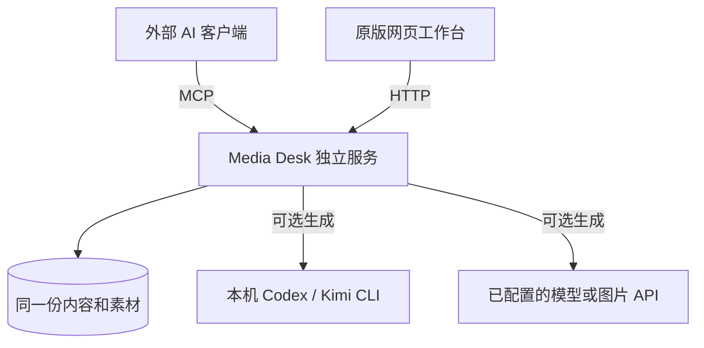

# Media Desk MCP

**独立的自媒体工作台：保留原版前端，让任意兼容 MCP 的 AI 接入，也可在工作台内调用已安装的 Codex、Kimi。**

本仓库从 [dsh-media-desk 2.7.2](https://github.com/woniuniuniu/dsh-media-desk/tree/3a23cb899691c29238138c76deb200114ce1830c) 拆出独立运行层。启动时不需要 DeepSeek Harness、DSH 插件市场或 DSH 账号。`client/` 的 26 个文件与 `assets/` 的 25 个文件逐字节保留，原有灵感、内容、排期、复盘、风格及成稿界面直接运行。

当前版本 **0.1.0，首个独立实现**。MCP/数据层和 CLI 协议适配有自动化验证；真实 Codex/Kimi 账号、真实模型输出、目标设备安装仍需在部署设备验收。准确进度见 [验证记录](docs/VALIDATION.md)。本次开发没有调用付费模型或消耗用户订阅额度。

## 两种使用方式，共享一份内容

| 使用方式 | AI 在哪里运行 | 工作台负责什么 |
| --- | --- | --- |
| 外部 AI 接入 MCP（推荐先用） | 用户已有的 Codex、Kimi 或其他 MCP 客户端 | 提供选题、风格、稿件、素材、排期、数据读写；外部 AI 完成创作再写回 |
| 工作台内直接生成 | 工作台所在机器的官方 Codex/Kimi CLI，或显式配置的 API | 从原助手/成稿界面发起任务，把生成结果保存到同一份内容中 |

外部 AI 写稿再调用 `media_desk_write_production`，不会让工作台再调用一次模型。上传、挂载图片同样只做数据操作。MCP 是接入协议，完整网页界面仍由独立服务提供；不要求每个 AI 客户端都能在对话里嵌入网页。



采用一个 Node 进程、一个本地数据目录。stdio 入口只是连接该服务的 MCP 代理，不再打开第二份数据存储。多个 AI 和网页可同时连接；数据修改串行写入，完整稿件/附件写入另有版本冲突检查。

## 本机启动

需要 Node.js **20.19+**（CI 使用 Node 22）。

```sh
git clone https://github.com/q652983601/media-desk-mcp.git
cd media-desk-mcp
npm ci
npm run build
npm start
```

打开 <http://127.0.0.1:4319>。服务启动后即有完整工作台和 `/mcp` 端点；不配置模型也能管理内容、编辑稿件、接收外部 AI 写入。

可复制 `.env.example` 为 `.env` 后调整配置。默认数据目录为 `~/.local/share/morandi-media-desk`，也可设置 `MEDIA_DESK_DATA_DIR`。内容与配置留在运行服务的机器上，代码更新不会覆盖该目录。同一目录只允许一个工作台进程写入。

### 给 AI 配置 MCP

先保持 `npm start` 运行，再把以下配置合入支持 stdio 的客户端配置。替换成仓库的**实际绝对路径**；客户端启动的是 `node`，不要把会打印 npm 提示的包装命令当作协议进程。

```json
{
  "mcpServers": {
    "media-desk": {
      "command": "node",
      "args": ["/ABSOLUTE/PATH/TO/media-desk-mcp/standalone/mcp.mjs"],
      "env": {
        "MEDIA_DESK_URL": "http://127.0.0.1:4319"
      }
    }
  }
}
```

也支持 Streamable HTTP，地址为 `http://127.0.0.1:4319/mcp`。各客户端的 URL/headers 配置格式不同，详见 [MCP 接入与完整写回示例](docs/MCP.md)。配置访问密钥后，stdio 代理需提供 `MEDIA_DESK_TOKEN`；HTTP 客户端使用 `Authorization: Bearer …`。

可以对外部 AI 这样说：

> 读取自媒体工作台中的选题、写作风格和规则，选择一个适合今天制作的选题，写成一篇小红书稿件，将正文、标题、封面文案和配图规划写回工作台。先不调用额外的付费图片服务，也不发布。

MCP 暴露 **17 个工具、3 个资源**，包括灵感、完整稿件、图片上传/挂载、排期、状态、表现数据、风格、规则、复盘和导出。完整 API 以工具发现结果和 [接口文档](docs/MCP.md) 为准。

## 在原界面内选择 Codex / Kimi

先在**运行工作台的同一台机器、同一系统用户**下安装并登录对应官方 CLI，然后在 `.env` 中显式启用：

```dotenv
MEDIA_DESK_AGENTS=codex,kimi
# 不在 PATH 时指定可执行文件的绝对路径
# MEDIA_DESK_CODEX_COMMAND=/absolute/path/to/codex
# MEDIA_DESK_KIMI_COMMAND=/absolute/path/to/kimi
# 可用型号由自己的 CLI/账号决定；不填时沿用 CLI 默认
# MEDIA_DESK_CODEX_MODELS=default
# MEDIA_DESK_KIMI_MODELS=default
```

重启服务，原模型选择器会出现配置的提供方和型号。运行时用官方 CLI 自己的账号状态，不复制登录凭据，不自动开通订阅，也不把浏览器会员登录变成 API Key。检测到 CLI 只代表程序存在，真实账号和生成能力尚需实际调用验证。

Codex 使用非交互 `exec --json`；Kimi 使用 `acp` 会话。两者共用进程管理、取消、超时和输出限制。具体协议、版本依据与限制见 [架构和运行引擎](docs/ARCHITECTURE.md)。默认不启用任何引擎。

另有可选的 OpenAI-compatible Chat Completions 适配：

```dotenv
MEDIA_DESK_BASE_URL=https://your-provider.example/v1
MEDIA_DESK_MODEL=your-model-id
MEDIA_DESK_API_KEY=your-private-key
```

填写以上配置后，实际生成可能按提供方规则计费。不要将真实密钥提交到仓库；本仓库忽略 `.env`，只提供不含凭据的示例。

## 保留前端的范围与能力边界

| 功能 | 当前独立版 |
| --- | --- |
| 原五个页面、成稿编辑、助手、设置、原素材与动效 | 原组件直接复用；不是重新绘制相似页面 |
| 多个 MCP 客户端读写与网页同步 | 已实现；独立外壳每 2 秒同步外部修改，输入或弹窗打开时暂停 |
| Codex/Kimi 内置文字引擎 | 已实现协议适配；真实账号/输出待部署设备验证 |
| AI 自行生成图片再写回 | 已实现上传和挂载，不需要 DSH |
| 原设置里的 HTTP 生图 API | 保留原实现，需要单独配置和真实提供方验收 |
| 原设置里的 DSH 订阅生图选项 | 界面因原样保留而仍存在；独立版没有对应 DSH 工具，不可用，不会偷偷切换到付费 API |
| 账号作品导入（Monid） | 默认禁用，显式启用 `MEDIA_DESK_ENABLE_MONID=1` 后才可调用，可能产生费用 |
| 排期 | 记录制作/发布计划；不自动向社交平台发布 |
| 导出 | 保存到工作台服务器目录；远程部署时不是浏览器直接下载包 |
| DSH 原文案 | 少量说明文字仍保留，以维持前端源码不改动；不代表运行依赖 |

源码一致性不等于所有操作系统上的逐像素一致；字体、浏览器和宿主视口也会影响画面。来源、主题 CSS 与验证脚本详见 [前端保留说明](docs/FRONTEND-PROVENANCE.md)。

## 部署选择

一人使用时，优先放在已经登录 Codex/Kimi 的电脑上，先跑通真实创作。需要长期开机或多设备访问时，再将**一个**服务放到 Lab，通过 HTTPS 反向代理访问；把需要的官方 CLI 登录配置在 Lab 的运行用户下。不要让每个 MCP 客户端启动一个独立存储服务。

远程部署、数据迁移和备份见 [部署说明](docs/DEPLOYMENT.md)。本仓库暂未替任何目标设备完成安装、账号登录或公网部署。

## 开发与验证

```sh
npm run verify:frontend   # 核对 51 个上游源码/素材文件的 SHA-256
npm run build             # 原组件 + 原主题 + React，打包为独立页面
npm test                  # 上游业务测试 + 独立服务/MCP/CLI 协议测试
npx playwright install chromium
npm run test:browser      # 真实服务、MCP 写入、浏览器读取与五页导航
```

[GitHub Actions](https://github.com/q652983601/media-desk-mcp/actions/workflows/standalone.yml) 使用公开仓库的标准 runner；不调用真实模型、不引用账号密钥，也不上传测试素材到第三方存储。

借鉴了 [OpenDesign 的原生运行引擎与外部 MCP 分层](https://github.com/nexu-io/open-design/blob/84dd08b5709bfa4bf4108ece8424d15e4062c982/docs/agent-adapters.md)，保留其适合这里的思路：工作台拥有内容，AI 作为可替换的执行入口。没有引入额外的任务平台、向量库或新的前端框架。

## 来源和许可证

MIT。保留原作者声明与原素材，见 [LICENSE](LICENSE)、[NOTICE.md](NOTICE.md)。主题 CSS 的 MIT 声明在 `standalone/theme/LICENSE`。本项目与上游作者、DeepSeek、OpenDesign、OpenAI、Moonshot AI 均无官方隶属关系。

[原版说明存档](docs/UPSTREAM-README.md) 仅供理解上游功能，不适用于独立版安装。
